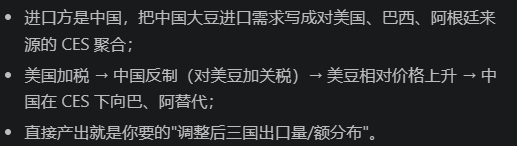

Armington CES 模型

**模型理解**
1. 在什么的限制下（输入，假设，条件下），用什么思想，以什么样子的输出量来解决什么问题。
   

**选择模型依据展示**
1. 题目出发：类似题目都是这么做的？
    核心思想符合（理解符合）：同一商品按来源国差异化、国别间是不完全替代（CES 聚合）--》需要有系数来衡量

    模型里面的参数有实际的现实对照：如这里的sigma大豆确实每个国家都不一样，sigma有限。
    模型的作用公式在过往例子中有证明：根据数据简要阐述，如2018年
    满足模型要求的限制

**合理取值寻找**
1. 论文出发？（网上，论文）数据出发？（拟合）
2. 敏感性分析（提供多种可能）

**结果的可视化展示和合理化分析**
1. 合理化分析--》不太会
    4.1 结论可以在过去的影子中找到--》不是第一次
    4.2 结论符合情理
    4.3 结论符合小模型得到的结果
    4.4 一些数值量的验证：如RME；或者可以经受实际案例的拷打

    补充：
        提结论的出彩方式：
            4.1 为什么会变化？（同级，趋势，情况比较等等）--》变化的深层原因

