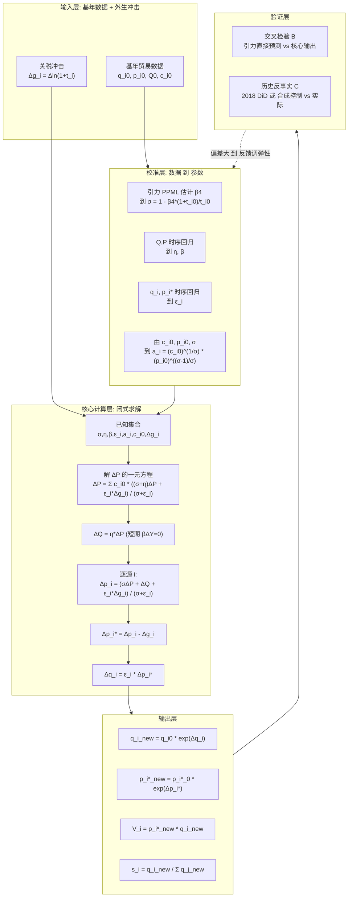
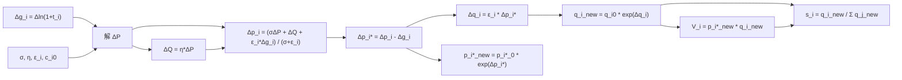

# 问题一 · 变量计算流程图（Computational Flow）

> 目的：从**计算角度**梳理模型中各变量的流动/依赖关系——哪些是先验输入、哪些靠数据校准、哪些由方程求解、哪些是最终输出，以及它们之间的因果链。

---

## 1. 全局数据流（Mermaid Flowchart）

> 注：所有含特殊字符（空格、`(` `)` `^` `*` `→` 等）的标签都已用**双引号**包裹，避免被 Mermaid 误判为节点形状语法。



**读法**：实线 = 数据/变量正向流动；虚线 = 验证不通过时回溯重估弹性，形成闭环。

---

## 2. 核心层内部变量依赖（从计算角度）



**依赖链一句话**：`关税冲击 → 解总体价指数 ΔP → 总进口量 ΔQ → 各源价 Δp_i → 净价 Δp_i* → 出口量 Δq_i → 出口量/额/份额`。

---

## 3. 计算顺序算法（伪代码）

```text
【阶段 0：校准（只做一次）】
  读入基年数据 q_i0, p_i0, Q0, c_i0
  读入面板数据 → PPML 引力 → 估计 β4 → σ = 1 - β4*(1+t_i0)/t_i0
  回归 Q~P,Y → η, β
  回归 q_i~p_i* → ε_i
  计算 a_i = (c_i0)^(1/σ) * (p_i0)^((σ-1)/σ)   // 取 P0 = 1

【阶段 1：给定关税情景】
  输入 Δg_i = Δln(1+t_i)   // 例如美豆关税 0→30% ⇒ Δg_US = ln(1.3)

【阶段 2：解总体变量】
  ΔP = 解一元方程:  ΔP = Σ_i c_i0 * ((σ+η)ΔP + ε_i*Δg_i) / (σ+ε_i)
  ΔQ = η*ΔP                      // 短期 ΔY=0

【阶段 3：逐源循环 i ∈ {US,BR,AR,ROW}】
  Δp_i   = (σ*ΔP + ΔQ + ε_i*Δg_i) / (σ + ε_i)
  Δp_i*  = Δp_i - Δg_i
  Δq_i   = ε_i * Δp_i*

【阶段 4：输出】
  q_i_new     = q_i0 * exp(Δq_i)
  p_i*_new    = p_i*_0 * exp(Δp_i*)
  V_i         = p_i*_new * q_i_new          // FOB 出口额
  s_i         = q_i_new / Σ_j q_j_new       // 市场份额

【阶段 5：验证】
  B: 引力直接预测关税后份额，与 s_i 比较 (Dev_i < 10%~15% 视为一致)
  C: 把同样方法套 2018 (+25%)，与真实美/巴变动对比
     不一致 → 回到阶段 0 调整 σ,η,ε_i 重跑
```

---

## 4. 变量分类表

| 类别 | 变量 | 来源 / 计算方式 |
|---|---|---|
| **外生输入** | $q_i^0, p_i^0, Q^0, c_i^0$ | 基年实际贸易数据 |
| **外生冲击** | $\Delta g_i=\Delta\ln(1+t_i)$ | 政策情景设定 |
| **校准参数** | $\sigma$ | 引力 $\beta_4$ 映射 |
| | $\eta,\beta$ | $Q\sim P,Y$ 回归 |
| | $\varepsilon_i$ | $q_i\sim p_i^*$ 回归 |
| | $a_i$ | 由 $c_i^0,p_i^0,\sigma$ 推导 |
| **中间变量** | $\Delta P$ | 一元方程求解（核心枢纽） |
| | $\Delta Q$ | $\eta\cdot\Delta P$ |
| | $\Delta p_i$ | 含关税价变化 |
| | $\Delta p_i^*$ | $\Delta p_i-\Delta g_i$（关税归宿） |
| | $\Delta q_i$ | $\varepsilon_i\cdot\Delta p_i^*$ |
| **输出变量** | $q_i^{\text{new}}$ | $q_i^0 e^{\Delta q_i}$ |
| | $p_i^{*,new}$ | $p_i^{*,0} e^{\Delta p_i^*}$ |
| | $V_i$ | 出口额（FOB） |
| | $\tilde s_i$ | 市场份额 |

---

## 5. 关键计算节点说明

- **$\Delta P$ 是计算枢纽**：它同时被关税冲击、替代弹性 $\sigma$、需求弹性 $\eta$、供给弹性 $\varepsilon_i$ 与基年份额 $c_i^0$ 决定，先解出它，其余变量全部顺推。
- **关税归宿在 $\Delta p_i$ 与 $\Delta p_i^*$ 之间拆分**：二者之差正好等于 $\Delta g_i$，体现"关税由出口商（净价降）与进口商（到岸价升）共同承担"。
- **出口量只走 $\Delta q_i=\varepsilon_i\Delta p_i^*$**：说明来源国出口量完全由其净价与供给弹性决定，与含关税价无直接关系（关税不进出口商账面）。
- **闭环**：验证层（B/C）若偏差大，反馈回校准层调整弹性重算，保证模型可信。
