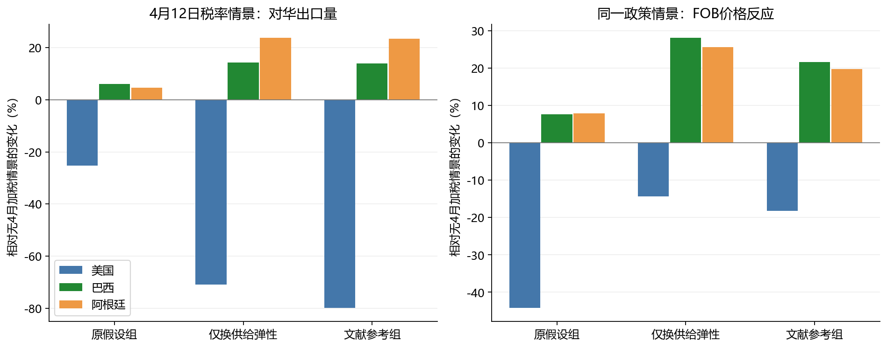

# 2025年4月关税影响：结果解释补充

**用途：针对4月政策核实与模型合理性诊断。原《解释结果文档.md》为通用假设演示，本补充用于4月研究。**

## 1. 本次分析口径

2024年年度结构下，2025年4月政策的比较静态冲击；不是4月当月到港量预测

政策输入、文献参数及其可迁移性见[政策与参数依据](2025年4月政策与参数依据.md)。主展示条件是旧附加税获批排除、且不享受本轮在途例外的主要非种用黄大豆货物。

34%仅为公告方案比较，不能解释为实际生效的一段关税水平。84%与125%分别是后续替换税率，不相加。

## 2. 第4步：价格反应是否合理——已完成的对照实验

| 参数组 | 国家 | 数量变化 | FOB价格变化 | FOB金额变化 |
| --- | --- | --- | --- | --- |
| 原假设组 | 美国 | -25.33% | -44.25% | -58.37% |
| 原假设组 | 巴西 | +6.01% | +7.57% | +14.04% |
| 原假设组 | 阿根廷 | +4.68% | +7.92% | +12.96% |
| 仅换供给弹性 | 美国 | -70.93% | -14.31% | -75.09% |
| 仅换供给弹性 | 巴西 | +14.33% | +28.16% | +46.52% |
| 仅换供给弹性 | 阿根廷 | +23.85% | +25.62% | +55.59% |
| 文献参考组 | 美国 | -79.98% | -18.21% | -83.63% |
| 文献参考组 | 巴西 | +14.00% | +21.64% | +38.68% |
| 文献参考组 | 阿根廷 | +23.51% | +19.71% | +47.85% |

这里都与同组参数下的‘保留3月10个百分点、没有4月新增关税’比较，未把3月影响算成4月影响。

原组与‘仅换供给弹性’组只有供给弹性不同，因此两者差异可以用于定位供给假设的作用。文献参考组还改变了需求与替代弹性，只能作为综合参数比较。

小供给弹性意味着数量稍有收缩就需要很大降价。中国市场单独闭合时，模型可能让美国通过过度降价消化冲击；提高对华供给弹性后，更多调整表现为减少销售数量。

不能只因某组结果更符合直觉，就认定其参数是真实值。本实验验证的是模型机制与参数敏感性，不是2025年外样本预测精度。

### 文献参考组的条件性分布

| 国家 | 年度基期尺度数量（百万吨） | FOB金额（十亿美元） | 数量份额 | 金额份额 |
| --- | --- | --- | --- | --- |
| 美国 | 4.431 | 1.667 | 4.59% | 3.26% |
| 巴西 | 87.069 | 46.773 | 90.14% | 91.50% |
| 阿根廷 | 5.094 | 2.680 | 5.27% | 5.24% |

本组达到假设供给上限的国家：巴西、阿根廷。这些国家的数量受人为容量约束影响，不能当作独立估计出的真实出口能力；其价格上涨也可能被偏紧的上限放大。

以上绝对量采用2024年年度基期尺度，表示高税率持续、模型调整后的条件性均衡；不是2025年4月当月出口量，也不是2025全年预测。份额只在三国合计内部计算。

## 3. 稳健性与校验

27组弹性组合只改变σ、η和供给弹性倍数，其他假设不变：

| 国家 | 4月数量效应范围 | 4月FOB价格效应范围 |
| --- | --- | --- |
| 美国 | -93.28% 至 -52.72% | -32.67% 至 -5.21% |
| 巴西 | +9.43% 至 +17.00% | +2.65% 至 +53.94% |
| 阿根廷 | +9.90% 至 +26.07% | +2.65% 至 +52.19% |

另将三国容量上限统一设为基期的1.1、1.2、1.5倍，仅为边界实验：

| 容量倍数 | 美国数量变化 | 美国价格变化 |
| --- | --- | --- |
| 1.1 | -72.03% | -14.72% |
| 1.2 | -79.65% | -18.05% |
| 1.5 | -85.61% | -21.52% |

区间不是置信区间；容量实验不是农业产能估计，亦未涵盖运输、非关税措施与季节性。

程序检查：10项全部通过；主情景和敏感性求解都逐次检查供需残差。

已完成数值一致性与参数稳健性检查。尚未完成历史事件外样本检验，不能声称预测已验证。

## 4. 第5步：论文组织与后续验证

可以直接使用本目录的《第一问建模与验证写作稿.md》组织方法章节；政策来源见《2025年4月政策与参数依据.md》。

要验证4月实际到港量，需要月度分来源净重、金额、在途合同和季节性信息；全年数据不能除以12替代。

建议用2017年校准、2018年事件作方向性外部检查，同时控制同期需求和收成。不能把两年全部变化当作关税效应，也不能用2024校准结果倒推2018作为验证。

2025年后续观察可用于事后检验，但不能作为4月决策时已知参数。当前结果最好写为政策比较静态分析。

## 5. 复现与结果字段

入口为 `python/Q1/run_april.py`；参数全部在 `config.json` 的 `april_2025` 字段。

`april_scenario_results.csv` 包含两种旧税排除条件、三组参数与四个政策情景；`april_robustness.csv` 包含弹性与容量检查。

`april_*_change_pct` 是相对无4月加税对照的效应；原 `*_change_pct` 字段仍是相对2024校准点，二者不得混用。

该程序不覆盖原演示输出；参数快照与检查保存在 `april_diagnostics.json`。
