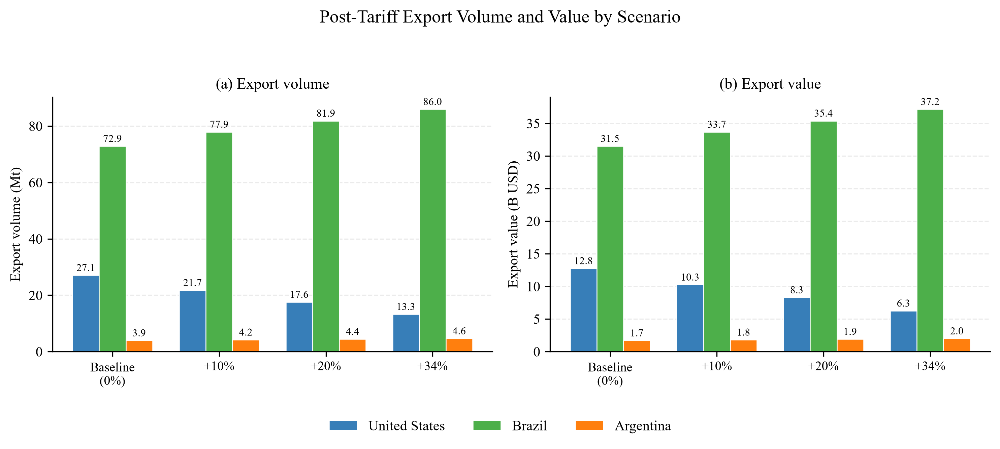
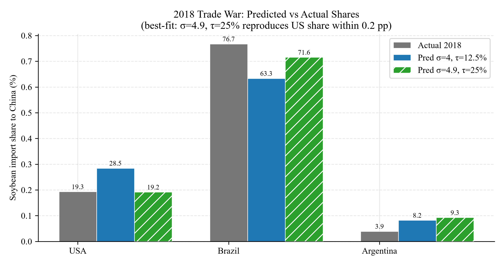

# 2.1 analysis of China's soybean import trade

2024 年三国合计对华出口约 1.035 亿吨、459.5 亿美元，规模处于十年最高水平。格局从十年前的“巴西、美国双雄”，演变为现在的“巴西一家独大、美国次之、阿根廷边缘化”。

### 十年趋势：2015 → 2024

| 指标 | 2015 | 2024 | 变化 |
|---|---|---|---|
| 三国对华出口总量 | 7797 万吨 | 1.035 亿吨 | +32.8% |
| 三国对华出口总额 | 298.5 亿美元 | 459.5 亿美元 | +53.9% |
| 巴西对华 | 4093 万吨 / 157.9 亿 | 7256 万吨 / 315.0 亿 | +77.3% / +99.5% |
| 美国对华 | 2732 万吨 / 105.2 亿 | 2706 万吨 / 127.6 亿 | -1.0% / +21.3% |
| 阿根廷对华 | 972 万吨 / 35.4 亿 | 392 万吨 / 16.9 亿 | -59.7% / -52.2% |

巴西已成为绝对主力。 份额从 2015 年的 52.5% 一路抬升到 2024 年的 70.1%，2023 年对华出口甚至达到 7447 万吨的历史峰值。中国对其依赖度显著加深。

美国经历了 2018 年的断崖式下滑，之后只是部分修复。 2018 年中美贸易摩擦使美国对华大豆出口从 2017 年的 3169 万吨暴跌到 824 万吨，份额从 34.4% 掉到 10.3%；同期巴西接盘，份额冲到 85.5%。2020 年第一阶段协议后美国回升到 3000 万吨上下，但份额稳定在 26% 左右，再未回到十年前的水平。

阿根廷持续边缘化。 2015 年还有 12.5% 的份额，到 2023 年只剩 1.7%（当年仅 174 万吨），主要受 2022/23 年严重干旱导致的国内减产拖累；2024 年回升到 392 万吨、3.8%，但远低于十年前的体量。

## 价格走势

对华大豆平均单价从 2015 年的 383 美元/吨，到 2021–2022 年国际粮价高企时冲到 591 美元/吨（2022 年），随后回落，2024 年为 444 美元/吨。金额增速（+53.9%）明显快于数量增速（+32.8%），说明这十年里价格上涨贡献了相当一部分进口额增长。

## 感性分析（引出下一问）

根据图像可以看出：23年和24年三国出口大豆给中国的出口份额变化很小（对应折线斜率小），因此我们或许可以假设：2025年的美国关税政策是影响2025年三国出口大豆出口份额的最重要因素，其余因素我们认为保持不变，这在下一个subsection很快会提及。

# 2.2 model building and the solution of q1

在2025年特朗普宣布对中国增加关税后，中方也提出了对包含美国进口大豆等产品进口的反制关税措施，在这一subsection中，我们借用贸易学中CES函数的思想，通过数学建模来预测2025年中国与美国、巴西和阿根廷三国的大豆贸易情况。

### subsection1：假设与justification

1. 替代弹性不变。我们假设三国大豆是不完全替代品（产地差异化、不同质），由参数替代弹性刻画，且三国的替代弹性参数都相同
2. 我们认为中国仅进口美国、巴西和阿根廷的大豆，即三国的大豆在中国的进口份额之和为1
3. 我们认为美国、巴西和阿根廷占中国的进口份额仅由出口价格决定，而出口价格不受关税影响，即出口价格保持不变
4. 我们认为中国对大豆的需求量不变
5. 我们将产能上限、汇率波动、农户降价保份额、质量差异等其他因素使用参数偏好同意概括，且偏好在预测中保持不变

### subsection2：参数决定

进口份额公式为：

1. sigma的确定

   取 GTAP 油籽类来源间弹性 ESUBM = 4.9 向下取整得中心值 σ = 4.0，落在文献常用区间 2–4 上沿，偏稳健。（这里有个论文引用）

2. tau的确定

   - S1_low = +10%：3/4 公告的大豆专项反制税率（最精确，逐字可引）；
   - S2_mid = +20%：日内瓦降级后的持续有效水平（10% 专项 + 对等轮保留 10%）；
   - S3_high = +34%：4 月对等轮 headline 税率（真实且广泛适用的峰值）。（这里应有来源引用）

3. alpha的确定

   我们以2024为基准年，根据已给数据中的情况反算alpha

### subsection3：模型预测

根据已经求得的alpha和sigma和tau能够预测进口份额的变化，不同国家有不同的变化率（求偏导数）

结果如下（图）
[text](Q1论文框架.md)  

### subsection4：模型效果验证

2018年中美贸易战期间，中国曾向美国大豆增加25%的关税，因此，我们可以以2017年为基准年重新确定alpha参数，并进行2018年的进口份额预测。

结果如下（图）

| 情景                      | σ       | 美(预测)  | 巴(预测)  | 阿(预测) | 美(实际)  | 巴(实际)  | 阿(实际) | MAE       |
| ------------------------- | ------- | --------- | --------- | -------- | --------- | --------- | -------- | --------- |
| **τ=25%（法定全额，主）** | **4.9** | **19.2%** | **71.6%** | **9.3%** | **19.3%** | **76.7%** | **3.9%** | **0.036** |
| τ=25%（法定全额）         | 4.0     | 22.5%     | 68.6%     | 8.9%     | 19.3%     | 76.7%     | 3.9%     | 0.054     |
| τ=12.5%（半年代权，对照） | 4.9     | 26.3%     | 65.2%     | 8.5%     | 19.3%     | 76.7%     | 3.9%     | 0.077     |
| τ=12.5%（半年代权）       | 4.0     | 28.5%     | 63.3%     | 8.2%     | 19.3%     | 76.7%     | 3.9%     | 0.089     |

可见预测的美国进口份额和真实值非常接近，巴西的进口份额预测值低于真实值，而阿根廷的进口份额预测值高于真实值，其中有一部分原因是2018年阿根廷遭遇了严重旱灾，导致我们的先验假设中“国家产能上限不变”发生了偏移，因此预测存在较大误差。
