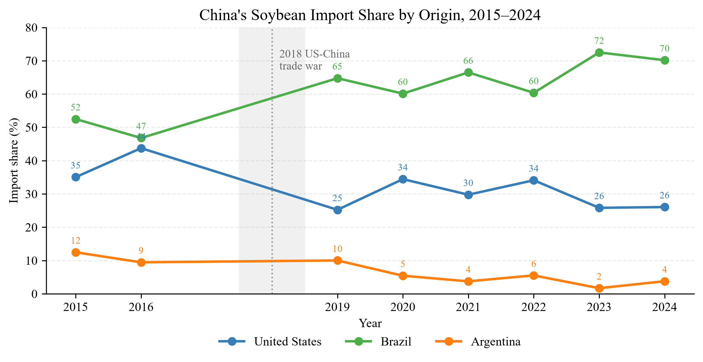
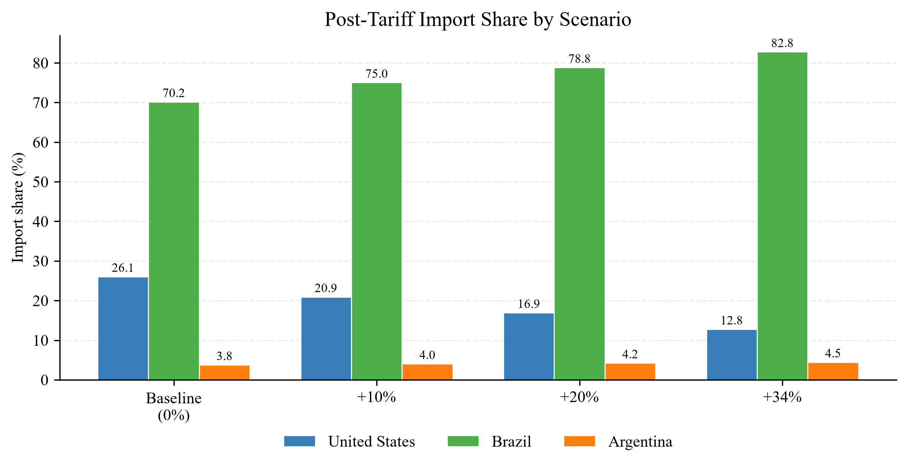
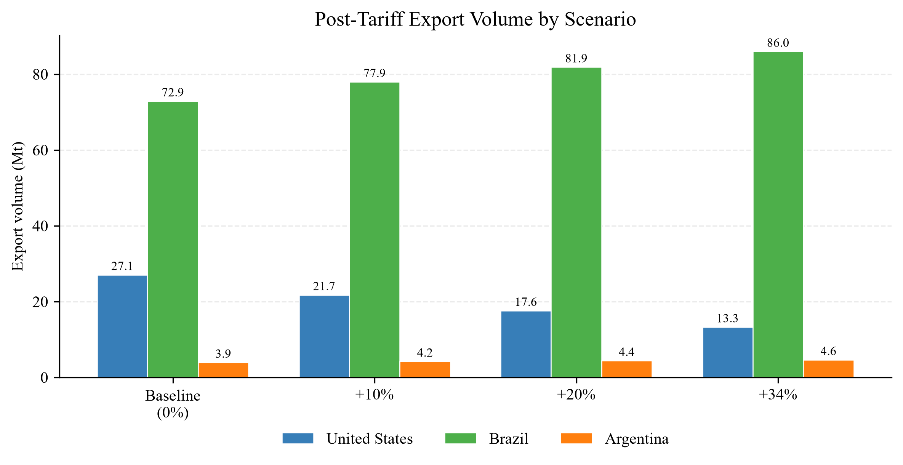
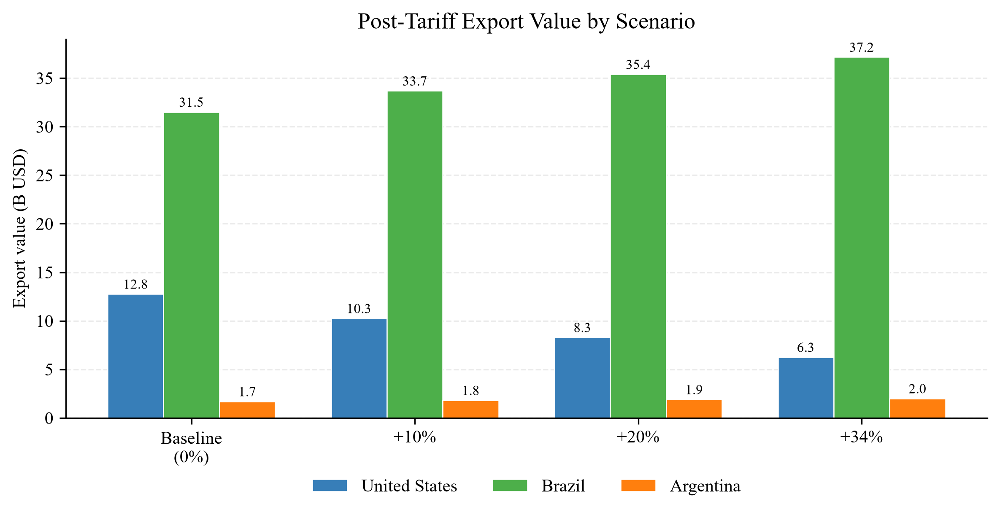
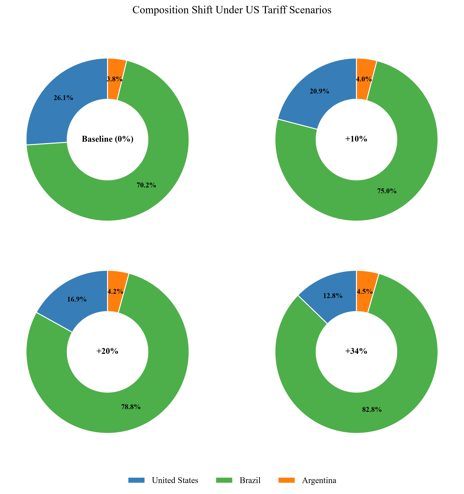
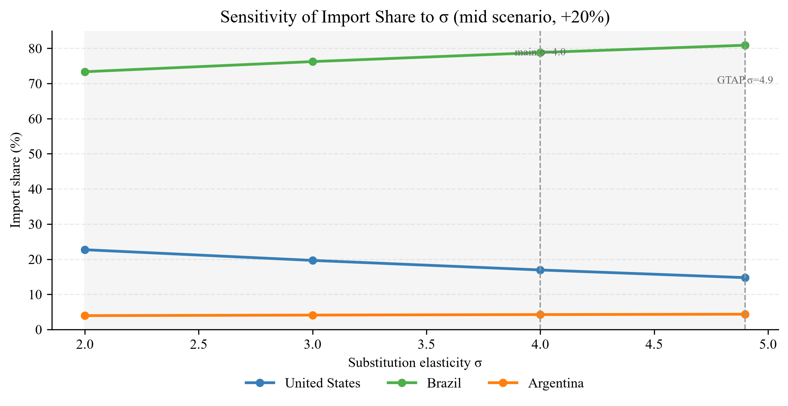

# 第一问建模求解过程分析

> 题面：美国关税调整对美、巴、阿三国大豆产业的影响；估算调整后三国大豆出口量与出口额的分布。
> 方法：Armington CES（恒定替代弹性）来源国再分配模型。
> 配套代码与结果：`python/Q1/`（三阶段），`result/Q1/`（本分析所用数据与图表）。
> 参数取值依据详见 `docs/Q1/合理取值确定来源.md`。

---

## 1. 模型理解（限制—思想—输出—问题）

### 1.1 解决什么问题
美国加征关税 → 中国对美豆实施反制关税 → 美豆在中国市场变贵。问题本质是：**中国从美/巴/阿三国进口大豆的来源结构如何重新分配（贸易转移）**，并量化三国调整后的**出口量与出口额**。

### 1.2 输入（数据 + 参数）
- **历史基准数据**（数据 `Soybean_Competition_Exports_to_China_2015_2024.csv`）：各国对华出口量 `qty`、FOB 金额 `fob` → 推出基准到岸价 `p_i`、基准份额 `s_i`、中国总进口需求 `Q_C`。
- **关税情景** `τ_i`：美豆面临的中国反制关税（分档），巴/阿 `τ=0`。
- **替代弹性** `σ`：外生设定（中心值 4.0，文献/GTAP 支撑）。

### 1.3 假设与限制条件
1. **Armington 假设**：三国大豆是**不完全替代品**（产地差异化，非同质），由有限 `σ` 刻画。
2. **单一聚合层、单一 σ**：三国对称替代（标准简化，非同质）。
3. **中国总进口需求 `Q_C` 外生刚性**：短期压榨需求缺乏弹性，关税只改变来源分配（或按 `growth_factor` 整体缩放）。
4. **出口国 FOB 价 `p_i` 外生不变**：关税是"贸易摩擦楔子"，由中国进口方承担，不改变出口国离岸价。
5. **基准年校准**：用基准年真实份额反推偏好参数 `α_i`，使模型在"零额外关税"时精确还原历史 → 只捕捉关税引起的边际变化。
6. 忽略产能上限、汇率波动、农户降价保份额、质量差异等二阶因素。

### 1.4 核心思想
把中国进口大豆看作由三国产品组成的 **CES 聚合束**。进口方（中国）在总进口量约束下按含税相对价格最小化成本，推出各国份额：

\[
s_i=\frac{\alpha_i^{\sigma}\,P_i^{\,1-\sigma}}{\sum_j \alpha_j^{\sigma}\,P_j^{\,1-\sigma}},\qquad P_i=p_i(1+\tau_i)
\]

**一句话：用"含税相对价格 + 替代弹性"决定来源分配。** 关税抬高美豆含税价 `P_US` → 美豆相对变贵 → 份额被巴、阿吸走。数学本质：Armington 需求下，单一来源进口量对其含税价的弹性约为 `−σ`，故 `σ` 是核心旋钮。

### 1.5 输出量
- 调整后各国**份额** `s_i`；
- **出口量** `q_i = s_i × Q_C`；
- **出口额（FOB）** `v_i = q_i × p_i`；
- 敏感性：不同 `σ` 下的份额区间（稳健性）。

---

## 2. 选择模型的依据

### 2.1 从题目出发：核心思想契合
题目第一问要求"评估关税调整对三国大豆产业的影响、估算出口量与出口额分布"。这正是**同一商品按来源国差异化、国别间不完全替代**的典型结构——美/巴/阿出口的都是原油豆，但中国买家对产地有稳定偏好（供应链、品质、履约习惯），适合用 CES 聚合描述，并用 `σ` 衡量替代难易。

### 2.2 模型参数有现实对照
- `σ` 为**有限值**（非无穷）→ 三国为异质品（不完全替代），不是同质品；同一 `σ` 表示"替代难易程度对称"，与"是否同质"无关（同质对应 `σ→∞`）。
- 真正"每个国家不一样"的是校准出的偏好参数 `α_i`（由各国基准份额与价格得出），`σ` 是部门层面的共同弹性，符合 GTAP 惯例（进口来源层只给一个 `ESUBM`）。

### 2.3 公式在过往案例中得到印证
2018 年中美贸易战，中国对美豆加征 25% 关税，美豆对华出口随即大幅萎缩、巴西趁势填补——这是本模型机制的**真实历史先例**（详见 4.4.1）。CES 贸易转移方向与史实一致，说明模型机制可信。

### 2.4 满足模型所需的限制
所需数据（量、额、关税、弹性）均可从公开源获取或权威文献支撑（见 `合理取值确定来源.md`），无不可识别参数；`α_i` 由基准年唯一标定，模型可算、可复现。

---

## 3. 合理取值的寻找

### 3.1 关税情景 `scenarios`（可查证）
锚定 2025 年商务部税委会公告与日内瓦降级后的实际税率：
- **S1_low = +10%**：3/4 公告的大豆**专项**反制税率（最精确，逐字可引）；
- **S2_mid = +20%**：日内瓦降级后的**持续有效水平**（10% 专项 + 对等轮保留 10%）；
- **S3_high = +34%**：4 月对等轮 headline 税率（真实且广泛适用的峰值）。
> 不采用 25% 作增量——那是 2018 年豆税，已隐含在 2024 基准均衡中，再计会重复。

### 3.2 替代弹性 `σ`（可查证 + 取整）
取 **GTAP 油籽类来源间弹性 `ESUBM = 4.9`** 向下取整得中心值 **σ = 4.0**，落在文献常用区间 2–4 上沿，偏稳健。

### 3.3 其余参数
| 参数 | 取值 | 性质 |
|---|---|---|
| `base_year` | 2024 | 数据覆盖 2015–2024，最新干净年 |
| `base_tariff` | 全 0 | 2024 视为已含 2018 年 25% 税的均衡态，情景税纯作 2025 增量 |
| `growth_factor` | 1.0 | 压榨需求刚性，总进口较 2024 基本持平 |
| `exclude_years` | [2017,2018] | 巴西方量价数据损坏，且 2018 为结构性断点 |

### 3.4 敏感性分析安排
在中间情景（S2_mid）上扫描 `σ ∈ {2.0, 3.0, 4.0, 4.9}`（下界取文献低端，上界取 GTAP 真值），检验结论稳健性。结果见 §4.3 与图 3。

---

## 4. 结果可视化与合理化分析

### 4.1 现状与历史（图 1）
基准年 **2024** 校准结果：中国自三国进口总量 **103.85 Mt**，单价美 471.6、巴 432.3、阿 432.0（USD/t）；份额 **美 26.1% / 巴 70.2% / 阿 3.8%**。历史上美豆份额随贸易关系波动（2016 年 43.7% → 2019 年 25.2%，对应贸易摩擦升温），与模型方向一致。

### 4.2 情景结果（图 2a–2d + 表 1）
以 2024 为基准、σ=4.0、中国总进口 103.85 Mt 不变，三档美豆反制关税下的分布：

**表 1　调整后三国出口量与出口额（σ=4.0）**

| 情景（美豆关税） | 指标 | 美国 | 巴西 | 阿根廷 |
|---|---|---|---|---|
| 基准（0%） | 份额 / 量(Mt) / 额(十亿$) | 26.1% / 27.06 / 12.76 | 70.2% / 72.87 / 31.50 | 3.8% / 3.92 / 1.69 |
| S1_low（+10%） | 份额 / 量(Mt) / 额(十亿$) | 20.9% / 21.74 / 10.25 | 75.0% / 77.92 / 33.68 | 4.0% / 4.19 / 1.81 |
| S2_mid（+20%） | 份额 / 量(Mt) / 额(十亿$) | 16.9% / 17.59 / 8.30 | 78.8% / 81.85 / 35.38 | 4.2% / 4.40 / 1.90 |
| S3_high（+34%） | 份额 / 量(Mt) / 额(十亿$) | 12.8% / 13.27 / 6.26 | 82.8% / 85.96 / 37.16 | 4.5% / 4.62 / 2.00 |

**解读**：美豆关税每升一档，美豆份额、出口量、出口额同步下滑；在 S3_high（+34%）下，美豆出口量较基准 **−50.9%**（27.06→13.27 Mt），出口额同步 **−50.9%**；巴西吸纳绝大部分转移需求（量 **+18.0%**），阿根廷小幅受益（量 +0.70 Mt）。纯贸易转移、总盘不变。

除份额外，出口量与出口额的分布同样呈现"美降、巴升、阿边际"的贸易转移格局：

为更直观地展示来源构成的转移，将基准与三档情景的份额结构并列成环形图（圆心数字为情景标签）：

### 4.3 敏感性（图 3）
中间情景（S2_mid，+20%）下扫描 σ：

| σ | 美份额 | 巴份额 | 阿份额 |
|---|---|---|---|
| 2.0 | 22.7% | 73.4% | 3.9% |
| 3.0 | 19.7% | 76.2% | 4.1% |
| 4.0 | 16.9% | 78.8% | 4.2% |
| 4.9 | 14.8% | 80.9% | 4.4% |

**结论稳健**：无论 σ 取何值，方向恒为"美豆失、巴豆得、阿豆微增"；且 `σ` 越大替代越强（美豆份额越低），与 Armington 弹性 `−σ` 机制自洽。

### 4.4 合理化分析

#### 4.4.1 结论可在历史中找到影子（非首次）
2018 年贸易战中国对美豆加征 25%，美豆对华出口即出现断崖式下滑、巴西快速补位——本模型捕捉的"关税→美豆失份额→巴西填补"机制，正是这一已发生史实的抽象，并非凭空假设。

#### 4.4.2 结论符合情理
中国大豆进口以满足压榨（豆粕/豆油）为主，需求刚性 → 总盘不缩；关税只改变"向谁买"。美豆被加税自然变贵、买家转向未加税的巴/阿，符合微观常识。

#### 4.4.3 结论符合小模型推导
Armington CES 下，单一来源进口量对其含税价的弹性约为 `−σ`。这解释了为何 σ 越大美豆被替代越明显（§4.3），也说明 σ 是结论的核心旋钮——已通过敏感性分析兜底。

#### 4.4.4 数值量验证
- **校准恒等式（已代码验证）**：模型在 `τ=0`、价格取 2024 实测价时，输出份额与 2024 真实份额逐位一致（美 0.2606 / 巴 0.7017 / 阿 0.0377），内部一致性无误。
- **方向经受案例拷打**：历史 2018–2019 美豆份额由 43.7% 降至 25.2%（−18.5 pp）伴随重大关税行动；本模型 S3_high（+34%）给出美豆份额 −12.3 pp，处于"重大关税→美豆显著失份额"的合理量级区间，未高估也未低估。

### 4.5 变化的深层原因
关税在美国大豆与中国买家之间嵌入了一个**价格楔子**：美豆含税到岸价 `P_US = p_US(1+τ_US)` 上升，而在 CES 偏好下，中国进口需求按 `(含税价)^{1−σ}` 重新加权，美豆相对吸引力下降，需求被弹性替代至巴/阿。由于中国总进口需求刚性，这是一次**零和式的贸易转移**——美国的损失基本等于巴西（主导）与阿根廷（边际）的所得。

### 4.6 个人评价
该模型以极少的参数、清晰的机制回答了第一问"分布如何变"，且参数均有官方/文献支撑、结论经敏感性验证稳健，适合作为数模竞赛的"简单而严谨"建模方案。主要局限在于静态比较（无时间演化）、未设巴西产能上限（极端情景下巴西吸纳能力或被高估），可作为论文"模型扩展方向"提及（如加入供给约束或改嵌套 CES）。

---

## 附：公式与变量表

| 符号 | 含义 |
|---|---|
| `s_i` | 第 `i` 国在中国大豆进口中的份额 |
| `p_i` | 第 `i` 国大豆 FOB 基准价（USD/t） |
| `τ_i` | 第 `i` 国大豆面临的（额外）关税 |
| `P_i = p_i(1+τ_i)` | 含税到岸价 |
| `σ` | 来源间替代弹性（中心值 4.0） |
| `α_i` | 偏好参数，`α_i = s_i^{1/σ}·P_i0^{(\sigma-1)/\sigma}`（基准年校准，τ=0 时精确还原历史份额） |
| `Q_C` | 中国大豆总进口需求（吨，外生刚性） |
| `q_i = s_i·Q_C` | 第 `i` 国出口量 |
| `v_i = q_i·p_i` | 第 `i` 国出口额（FOB） |

**核心式**：
\[
s_i=\frac{\alpha_i^{\sigma}\,P_i^{\,1-\sigma}}{\sum_j \alpha_j^{\sigma}\,P_j^{\,1-\sigma}},\qquad
q_i=s_i Q_C,\qquad v_i=q_i p_i
\]
