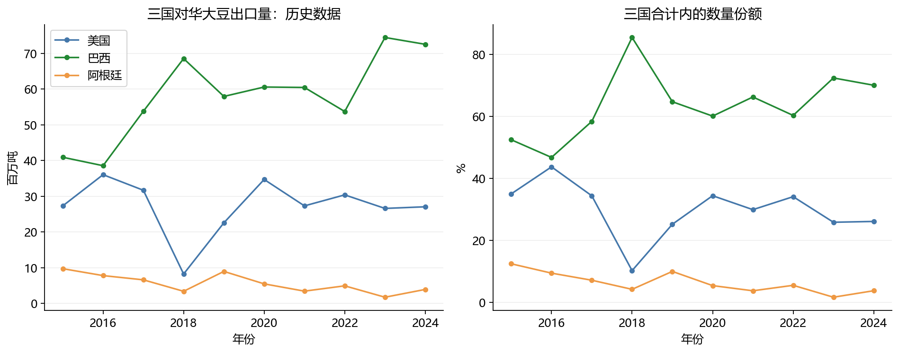
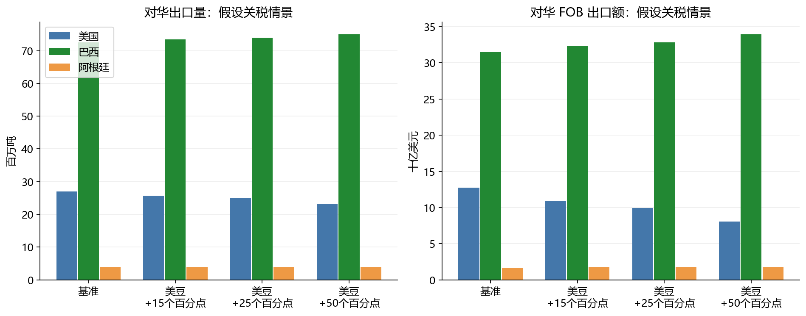
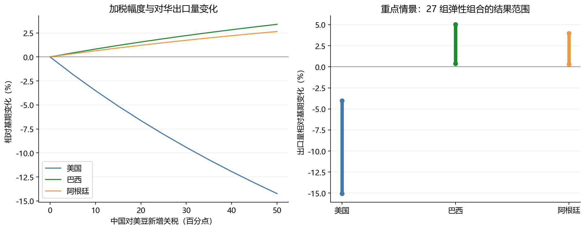

# 第一问：中国市场大豆局部均衡模型——结果解释

**2025年4月专用研究请优先阅读[4月结果解释补充](2025年4月结果解释补充.md)及[政策与参数依据](2025年4月政策与参数依据.md)。本文件保留原通用假设演示。**

**本报告由程序根据本次结果自动生成。2024 年为数据基期；关税情景和弹性为假设，不代表已核验的政策预测。**

## 1. 历史数据和基期

| 国家 | 对华出口量（百万吨） | FOB 出口额（十亿美元） | FOB 单价（美元/吨） | 三国数量份额 |
| --- | --- | --- | --- | --- |
| 美国 | 27.059 | 12.761 | 471.60 | 26.14% |
| 巴西 | 72.558 | 31.500 | 434.14 | 70.08% |
| 阿根廷 | 3.919 | 1.693 | 431.95 | 3.78% |




图 1 左侧为历史数量，右侧为三国合计内的数量份额。基期最大供应方是巴西。

历史曲线仅描述贸易格局，不能把某一年全部变化归因于关税；天气、价格和需求等因素也可能影响贸易。

来源为原始 CSV 的年度 HS1201 出口记录，数量使用 netWgt/1000，金额使用 fobvalue。

原文件行末有额外空字段，预处理仅删除多出的空字段；不改写原数据，不叠加 World 行。

所有份额只针对美国、巴西、阿根廷合计，不能解释为中国全部进口的市场份额。

## 2. 模型机制与假设

只建立中国购买三国大豆这一子市场的静态局部均衡，不包含中国国产大豆、其他进口来源或全球目的地。

美国政策通过中国反制情景间接进入模型；直接进入价格公式的税率是中国对来源国大豆的进口税率。

设基期数量为 qᵢ₀，FOB 价格为 pᵢ₀，单位运费为 fᵢ，适用税率为 τᵢ，含税价为 cᵢ。

```text
c_i = (p_i + f_i) * (1 + tau_i)
r_i = c_i / c_i0
w_i = c_i0*q_i0 / sum_j(c_j0*q_j0)
I = [sum_i w_i * r_i^(1-sigma)]^(1/(1-sigma))
q_i^D = q_i0 * r_i^(-sigma) * I^(sigma-eta)
q_i^S = min[q_i0 * (p_i/p_i0)^epsilon_i, capacity_i]
q_i^D = q_i^S
V_i = p_i*q_i
```

σ=1 时使用 I=exp(Σwᵢ ln rᵢ) 的连续极限。以 log(pᵢ/pᵢ₀) 求解，保证价格为正。

I 是归一化 CES 价格指数；综合需求比率为 I^(-η)，实际进口吨数必须计算 Σqᵢ，两者不能混用。

供给是面向中国市场的简化供给曲线；其收缩不能直接解释为全国减产。供给上限绑定时，价格仍由进口需求与固定上限共同决定。

| 配置项 | 本次取值 |
| --- | --- |
| substitution_elasticity | 4.0 |
| demand_elasticity | 0.3 |
| supply_elasticity | {'USA': 0.5, 'BRA': 0.8, 'ARG': 0.6} |
| base_tariff | {'USA': 0.03, 'BRA': 0.03, 'ARG': 0.03} |
| freight_usd_per_tonne | {'USA': 0.0, 'BRA': 0.0, 'ARG': 0.0} |
| capacity_multiplier | {'USA': 1.3, 'BRA': 1.2, 'ARG': 1.3} |


**参数性质：** 税率、运费、弹性和供给上限均为可调假设，非数据估计。3%仅作统一基准税率假设，不代表已核验2024年实际有效税率；运费为零是数据缺失下的简化。新增关税为中国对美国大豆加征的百分点，不是美国进口税率。供给是对华可供给量，不是全国产量。

基期贸易数据用于校准数量、单价和 CES 权重；弹性、运费、税率和容量没有通过本数据识别。

容量倍数以基期对华数量为基准，不是依据农业产量测算的物理产能。供给弹性与容量共同限制扩张。

FOB 单价是出口金额/净重得到的年度单位价值，未区分品质结构。运费设零会影响价格传导幅度。

模型未设置政策响应函数，无法由任意美国进口关税自动推导中国反制税率。

方法参考：[世界银行 WITS Armington 说明](https://wits.worldbank.org/WITS/WITS/WITSHELP/Content/SMART/Demand%20side%20the%20Armington.htm)。本代码是自建非线性局部均衡系统，不是 SMART 软件实现。

## 3. 关税情景结果

情景中的 +15/+25/+50 均为百分点，分别加在基准税率上；只改变美国来源税率。

例如默认基准 3%，加 25 个百分点后为 28%，并非把 3% 乘以 1.25。以下均为假设模拟。

| 情景 | 国家 | 百万吨 | 十亿美元 | 数量份额 | 金额份额 |
| --- | --- | --- | --- | --- | --- |
| 基准 | 美国 | 27.059 | 12.761 | 26.14% | 27.77% |
| 基准 | 巴西 | 72.558 | 31.500 | 70.08% | 68.55% |
| 基准 | 阿根廷 | 3.919 | 1.693 | 3.78% | 3.68% |
| 美国+15个百分点 | 美国 | 25.675 | 10.902 | 24.91% | 24.23% |
| 美国+15个百分点 | 巴西 | 73.425 | 32.354 | 71.25% | 71.91% |
| 美国+15个百分点 | 阿根廷 | 3.955 | 1.735 | 3.84% | 3.86% |
| 美国+25个百分点 | 美国 | 24.878 | 9.917 | 24.20% | 22.27% |
| 美国+25个百分点 | 巴西 | 73.934 | 32.860 | 71.93% | 73.78% |
| 美国+25个百分点 | 阿根廷 | 3.977 | 1.760 | 3.87% | 3.95% |
| 美国+50个百分点 | 美国 | 23.206 | 8.049 | 22.70% | 18.37% |
| 美国+50个百分点 | 巴西 | 75.021 | 33.957 | 73.37% | 77.49% |
| 美国+50个百分点 | 阿根廷 | 4.023 | 1.815 | 3.93% | 4.14% |




### 重点情景：美国+25个百分点

- 美国：对华出口量变化 -8.06%，FOB 单价变化 -15.47%，出口额变化 -22.29%。
- 巴西：对华出口量变化 +1.90%，FOB 单价变化 +2.38%，出口额变化 +4.32%。
- 阿根廷：对华出口量变化 +1.48%，FOB 单价变化 +2.48%，出口额变化 +4.00%。

三国对华出口总吨数变化 -0.72%，CES 价格指数变化 +3.09%。

图 2 展示数量和金额两个维度。关税使美国大豆的相对采购成本上升，需求重新分配；美国出口价格下降可以吸收部分冲击，因此数量不会按税率一比一下降。

巴西、阿根廷的需求增加会推动出口价格上升，供给响应和容量约束限制其扩张。

出口额同时受数量与 FOB 价格影响，不能只用数量变化率判断收入变化。

这是对华出口销售收入，不是利润、生产者剩余或全球产业总收入，也不包括中国征收的关税。

## 4. 敏感性和数值检验




图 3 左侧固定其他参数，只改变中国对美豆的加税幅度。右侧为重点情景下弹性组合的最小—最大范围。

本次参数网格：{'substitution_elasticity': [2.0, 4.0, 6.0], 'demand_elasticity': [0.1, 0.3, 0.6], 'supply_scale': [0.5, 1.0, 2.0], 'tariff_grid': [0.0, 0.05, 0.1, 0.15, 0.2, 0.25, 0.3, 0.35, 0.4, 0.45, 0.5]}

| 国家 | 数量变化范围 | 出口额变化范围 |
| --- | --- | --- |
| 美国 | -15.06% ~ -4.02% | -27.85% ~ -18.54% |
| 巴西 | +0.38% ~ +5.05% | +1.35% ~ +8.33% |
| 阿根廷 | +0.30% ~ +3.97% | +1.31% ~ +7.41% |

这些范围是参数敏感性区间，**不是统计置信区间**，且未涵盖税率基准、运费和容量假设的不确定性。

主情景最大供需相对残差：3.476e-13。

主情景容量约束绑定记录：无

检查结果：
```json
{
  "baseline_quantity_reproduced": true,
  "baseline_price_reproduced": true,
  "value_equals_fob_times_quantity": true,
  "quantity_shares_sum_to_one": true,
  "value_shares_sum_to_one": true,
  "positive_quantities_prices": true,
  "capacity_respected": true,
  "us_volume_nonincreasing_in_tariff": true,
  "binding_capacity_case_solved": true,
  "sigma_one_limit_reproduces_baseline": true
}
```

基期复现和数值残差只能说明校准、求解与会计关系正确，不等于预测准确。当前没有政策后观测用于外样本检验。

## 5. 如何用于论文与后续改进

可以据此论述‘反制关税改变相对价格，引起对华采购转移，并通过供给响应影响 FOB 价格与出口收入’。

目前应将数值称为‘给定弹性与税率假设下的情景模拟’，不要写成 2025 年实际结果或已验证预测。

正式论文应补充明确政策时点的中国适用税率（含豁免）、运费和有出处的弹性参数，再修改 config.json 重跑。

仅有 2015—2024 年数量和金额不能可靠识别全部弹性；本代码没有用这 10 个年度样本强行回归。

本模型不回答美国转销第三国的数量、全球出口、全国种植面积或利润损失。这与本次只考虑中国市场的范围一致。

## 6. 文件与复现

运行入口：`python/Q1/run.py`；参数：`python/Q1/config.json`；图形配置：`python/Q1/config_pic.json`。

完整文件说明见 `python/Q1/docs/file_tree.md`。原始数据保持不变。结果表单位为吨、美元、美元/吨；图表使用百万吨和十亿美元。

每次运行更新固定文件名：4 张 CSV、3 张 PNG、2 个 JSON 和本文档，不逐情景生成文件。
